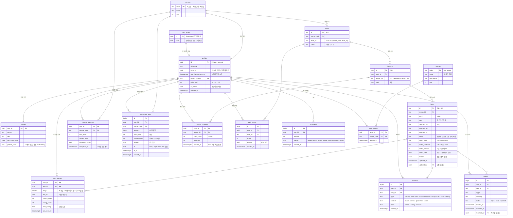
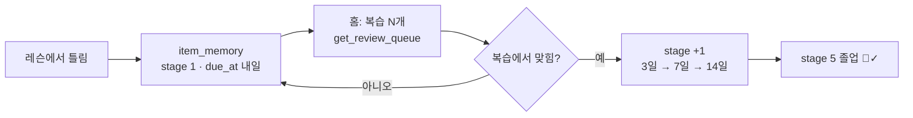

# 2단계 · 설계 — ERD (단어정원 DB)

> 설계 본문: [2_설계.md](2_설계.md) 3절 · 그림으로 보기: [mockups/erd.html](mockups/erd.html) (로컬 서버 `mockup` → `http://localhost:8767/mockups/erd.html`)
> 표기: **PK** 기본 키 · **FK** 다른 표를 가리킴 · **UK** 겹치면 안 됨 · `||--o{` 하나 : 여러 개 · `||--||` 하나 : 하나

## 1. 전체 그림

## 2. 묶음별 설명

| 묶음 | 테이블 | 누가 쓰나 | 권한 (RLS) |
|---|---|---|---|
| ① 콘텐츠 | `courses` · `levels` · `lessons` · `items` | 관리자 (편집 화면) | 로그인한 사람 읽기(숨김 단어는 관리자만), 쓰기는 관리자만 |
| ② 사용자 | `profiles` · `course_progress` · `placement_tests` | 가입 트리거 · DB 함수 | 본인 · 관리자 읽기. 본인은 닉네임 · 코스 · 하루 목표만 고침 |
| ③ 학습 기록 | `lesson_progress` · `level_exams` · `item_memory` · `attempts` | DB 함수만 | 본인 · 관리자 읽기, 직접 쓰기 없음 |
| ④ 리워드 · 신고 | `xp_events` · `streaks` · `badges` · `user_badges` · `reports` | DB 함수 · 신고 버튼 · 관리자 | 본인 · 관리자 읽기. 신고 만들기는 본인, 처리는 관리자 |

## 3. 키 · 규칙

| 규칙 | 내용 |
|---|---|
| 콘텐츠 id | 사람이 읽을 수 있는 글자 id (`E-1-2-05`) — CSV · 음성 파일 이름과 같음 |
| 사용자 기록 PK | 한 사람 × 한 대상은 한 줄 (`course_progress` · `lesson_progress` · `item_memory` · `user_badges` 는 두 칸을 합친 PK) |
| 쌓이는 기록 | `placement_tests` · `level_exams` · `attempts` · `xp_events` · `reports` 는 일련번호 PK, 지우지 않고 쌓음 |
| 단어 삭제 | 하지 않음 — `items.hidden = true` (학습 기록 보호) |
| 음성 주소 | `VITE_AUDIO_BASE` + `audio_word` + `?v=` + `audio_version` |
| 사용자 삭제 | `auth_users` 를 지우면 그 사람의 ②③④ 기록도 함께 지워짐 (on delete cascade) |
| 레슨 뒤 정원 | 다 맞힌 단어는 `stage` 2(잎, 3일 뒤), 틀린 단어는 1(새싹, 1일 뒤) — 이미 더 자란 단어는 그대로 |
| 관리자 확인 | `private.is_admin()` (앱 API에 드러나지 않는 스키마) |
| 실제 DB | 2026-11-24 `word-garden` 프로젝트에 적용 · 검사 완료 → [3-1_DB_구현.md](3-1_DB_구현.md) |
| 자주 찾는 칸 색인 | `item_memory(user_id, due_at)` 복습함 · `attempts(item_id)` 자주 틀리는 단어 · `attempts(user_id, created_at)` 주간 리포트 · `xp_events(user_id, created_at)` 하루 목표 |

## 4. 오늘 할 일이 만들어지는 흐름

