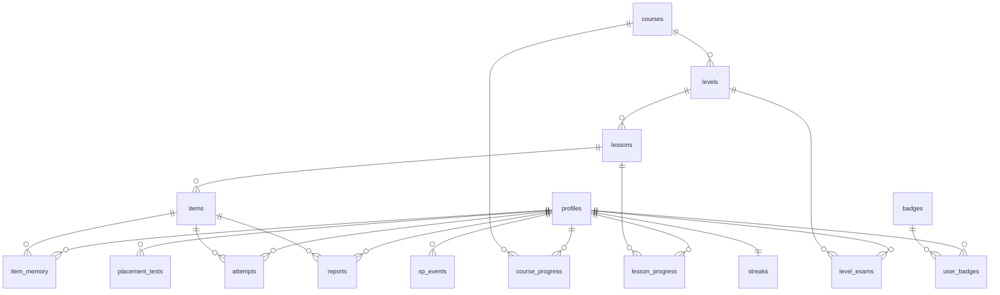

# 2단계 · 설계 — 단어정원 (Word Garden)

> 진행: 2026-11-24, 한 질문씩 결정 (D1~D6) + 목업으로 디자인 선택
> 상태: **확정**
> 기획: [1_기획_요구분석.md](1_기획_요구분석.md) · 콘텐츠: [1-2_콘텐츠_준비.md](1-2_콘텐츠_준비.md) · 목업: [mockups/design.html](mockups/design.html)

---

## 1. 결정 요약

| # | 항목 | 결정 |
|---|---|---|
| D1 | 기술 | React + Vite + TypeScript + Tailwind CSS, **PWA**(홈 화면 추가). 기록 · XP · 복습 일정 계산은 Supabase DB 함수 |
| D2 | DB | 콘텐츠 / 사용자 / 학습 기록 / 리워드 · 신고 4묶음 (3절). 문제는 DB에 저장하지 않고 단어에서 그때그때 생성 |
| D2 | 음성 파일 | **Supabase Storage** `audio` 버킷(누구나 읽기). DB에는 파일 이름 + 버전만 |
| D3 | 화면 | 18개 (4절), 아래 탭 4개 — 홈 · 복습 · 오답 노트 · 마이 |
| D4 | 디자인 | **단어 정원** 템플릿 + 효과 조합 (5절) |
| D4+ | 주니어(초등) | 새싹이 · 자라는 화분 · 물방울 연속 정답 + 문제 유형 4개 추가 (6절) |
| D5 | 인증 메일 | **PoC 전용 Gmail 새 계정** + 앱 비밀번호 → Supabase SMTP. 정식 공개 때 도메인 + Resend |
| D6 | 앱 이름 | **단어정원** (영문 Word Garden, 코드 · 주소용 `word-garden`) |

## 2. 기술 구성

| 부분 | 기술 |
|---|---|
| 화면 | React 18 + TypeScript, Vite 빌드, Tailwind CSS |
| 앱처럼 쓰기 | PWA — manifest(이름 "단어정원", 아이콘), 서비스 워커로 화면 파일 · 음성 캐시 |
| 로그인 | Supabase Auth — 이메일 + 비밀번호, **6자리 코드(OTP)** 인증 · 비밀번호 찾기 |
| DB | Supabase Postgres + RLS + DB 함수(RPC) |
| 음성 파일 | Supabase Storage `audio` 버킷 |
| 음성 인식 · 예비 음성 | 브라우저 내장 (SpeechRecognition · speechSynthesis) |
| 효과음 | 파일 없이 Web Audio로 합성 (5-3) |
| 그림 | Twemoji 그림 (CC BY 4.0, 앱 안에 출처 표시) |
| 배포 | Vercel 정적 사이트 — GitHub `ax-english-poc` 연결, 푸시하면 자동 배포 |

### 환경변수

| 이름 | 어디에 | 내용 |
|---|---|---|
| `VITE_SUPABASE_URL` | Vercel · 로컬 `.env` | 프로젝트 주소 |
| `VITE_SUPABASE_PUBLISHABLE_KEY` | Vercel · 로컬 `.env` | 공개 키 (화면용) |
| `VITE_AUDIO_BASE` | Vercel · 로컬 `.env` | 음성 파일 앞부분 주소 (옮길 때 이 값만 바꿈) |
| `SUPABASE_SECRET_KEY` | **이 PC 환경변수에만** | 음성 업로드 · 콘텐츠 올리기 스크립트용. 화면 파일 · git · 채팅에 넣지 않음 |

### 폴더

```
app/                 React 웹앱
  src/screens/       화면 18개
  src/quiz/          문제 유형 11개 (6-2)
  src/garden/        정원 부품 — 새싹이, 화분, 물방울, 꽃 피우기, 정원 현황
  src/sound/         효과음 합성(물방울 정원), 발음 재생 · 예비 음성
  src/lib/           Supabase 연결, 문제 만들기, 화면 채점
  src/styles/        단어 정원 토큰
  public/            PWA 아이콘 · manifest
supabase/
  migrations/        테이블 · 권한 · DB 함수 SQL
  seed/              CSV → DB 올리기
content/             단어 CSV · 음성 원본 (콘텐츠 준비 단계)
scripts/             검사 · 음성 생성 · Storage 업로드
mockups/             디자인 목업
```

## 3. 데이터베이스

### 3-1. 그림 (ERD)

> 칸(컬럼)까지 모두 적은 상세 ERD: **[2-1_ERD.md](2-1_ERD.md)** · 그림으로 보기: [mockups/erd.html](mockups/erd.html)

아래는 테이블 사이 관계만 줄인 그림이다.



### 3-2. 콘텐츠 (로그인한 사람 누구나 읽기, 관리자만 쓰기)

| 테이블 | 칸 |
|---|---|
| `courses` | `code` text PK (E · M · A), `name`, `sort` |
| `levels` | `id` text PK (`E-1`), `course_code` → courses, `level_no` 1~3, `name` |
| `lessons` | `id` text PK (`E-1-2`), `level_id` → levels, `lesson_no` 1~3, `topic` |
| `items` | `id` text PK (`E-1-2-05`), `lesson_id` → lessons, `word`, `pos`, `meaning_ko`, `example_en`, `example_ko`, `emoji`(초등만, 없으면 그림 문제 제외), `audio_word`(`E-1-2-05_w.mp3`), `audio_sentence`(`…_s.mp3`), `audio_version` int, **`audio_stale`** bool (영어를 고쳐 음성 다시 만들기 필요), **`hidden`** bool (숨김 — 삭제 대신), `updated_at`, `updated_by` |

### 3-3. 사용자

| 테이블 | 칸 |
|---|---|
| `profiles` | `id` uuid PK → auth.users, `nickname`, `is_minor` bool(만 14세 미만 = 보호자 가입), `guardian_consent_at`, `current_course` → courses, `daily_goal` 30 · 60 · 100, **`is_admin`** bool, `created_at` |
| `course_progress` | PK(`user_id`, `course_code`), `start_level`, `current_level`, `placement_done` bool, `completed_at` |
| `placement_tests` | `id`, `user_id`, `course_code`, `answers` jsonb, `result_level`, `chosen_level`, `skipped` bool, **`fit`** (쉬웠어요 · 적당해요 · 어려웠어요 — 성공 기준 S4, 첫 레슨 뒤 입력), `fit_at`, `created_at` |

### 3-4. 학습 기록 (본인 것만)

| 테이블 | 칸 |
|---|---|
| `lesson_progress` | PK(`user_id`, `lesson_id`), `best_score` 0~100, `attempts`, `passed_at` |
| `level_exams` | `id`, `user_id`, `level_id`, `score`, `passed` bool, `created_at` |
| `item_memory` | PK(`user_id`, `item_id`), **`stage`** 0~5, `due_at` date, `correct_streak`, `wrong_count`, `ever_wrong` bool(오답 노트), `last_seen_at` |
| `attempts` | `id`, `user_id`, `item_id`, `qtype`(6-2 코드), `context`(lesson · review · placement · exam), `result`(correct · wrong · skipped), `created_at` |

`item_memory.stage` = 복습 단계 = 정원 그림

| stage | 다음 복습 | 정원 |
|---|---|---|
| 0 | 처음 봄 | 🌰 씨앗 |
| 1 | 1일 뒤 | 🌱 새싹 |
| 2 | 3일 뒤 | 🌿 잎 |
| 3 | 7일 뒤 | 🌷 꽃 |
| 4 | 14일 뒤 | 🌳 나무 |
| 5 | 졸업 (14일 복습 통과) | 🌳✓ 다 외움 |

맞히면 한 단계 위, 틀리면 1단계(1일)로. 카드 복습의 "다시 · 어려움 · 알맞음 · 쉬움"은 1단계 · 그대로 · 한 단계 위 · 두 단계 위.

### 3-5. 리워드 · 신고

| 테이블 | 칸 |
|---|---|
| `xp_events` | `id`, `user_id`, `amount`, `reason`(answer · lesson · perfect · review · speak · exam · rain_bonus), `created_at` |
| `streaks` | `user_id` PK, `current`, `best`, `last_active_date`, `protect_week`(이번 주 보호 사용) |
| `badges` · `user_badges` | `code` PK, `name`, `description`, `sort` / PK(`user_id`, `badge_code`), `earned_at` |
| `reports` | `id`, `user_id`, `item_id`, `qtype`, `message`, `status`(open · fixed · rejected), `created_at`, `resolved_at`, `resolved_by` |

### 3-6. 권한 (RLS)

| 대상 | 읽기 | 쓰기 |
|---|---|---|
| 콘텐츠 4개 | 로그인한 사람 (`hidden` 단어는 관리자만) | 관리자만 |
| `profiles` | 본인 · 관리자 | 본인(닉네임 · 코스 · 하루 목표만). **`is_admin`은 본인이 못 바꿈** |
| 학습 기록 · 리워드 | 본인 · 관리자(현황용) | **직접 쓰기 없음** — DB 함수만 |
| `reports` | 본인 것 · 관리자 | 만들기는 본인, 처리는 관리자 |
| Storage `audio` | 누구나 | 업로드 스크립트(비밀 키)만 |

### 3-7. DB 함수

| 함수 | 하는 일 |
|---|---|
| `handle_new_user` (가입 트리거) | 가입 정보(닉네임 · 만 14세 미만 · 보호자 동의)로 `profiles` · `streaks` 만들기 |
| `submit_placement(course, answers)` | 레벨 테스트 판정 (기획 3-5 규칙) → `placement_tests` · `course_progress` |
| `choose_start_level(course, level)` | 결과 화면에서 "한 단계 아래" · 건너뛰기 선택 반영 |
| `submit_lesson(lesson_id, answers)` | **정답을 다시 확인**(말하기 · 카드 자가 평가는 화면 판단을 믿음) → 점수 · 통과(80%) · XP · `item_memory` · `attempts` · 스트릭 · 배지 → 결과 돌려줌 |
| `get_review_queue(course)` | 오늘 복습할 단어 (`due_at` ≤ 오늘) |
| `submit_review(answers)` | 복습 결과 → 단계 · XP(복습 완료 +15) |
| `submit_level_exam(level_id, answers)` | 15문제 80% → 다음 레벨 열기 |
| `submit_fit(fit)` | "시작 레벨이 적당했나요?" 설문 |
| `report_item(item_id, qtype, message)` | 오류 신고 |
| `private.is_admin()` · `admin_stats()` | 관리자 확인(앱 API에 드러나지 않는 `private` 스키마) · 현황 숫자 (가입자, 코스별 인원, 레벨 테스트 분포, 통과율, 다시 맞힌 비율, 자주 틀리는 단어 · 유형 Top 10) |
| `choose_start_level(course, level, skipped)` | 결과 화면의 한 단계 아래 · 건너뛰기 |

> 구현 결과 · 검사 기록: [3-1_DB_구현.md](3-1_DB_구현.md)

## 4. 화면 (18개)

| # | 화면 | 주소 | 내용 |
|---|---|---|---|
| 1 | 시작 | `/` | 소개 한 줄, 시작하기 · 로그인 |
| 2 | 가입 | `/signup` | 만 14세 이상 / 미만(보호자 가입), 이메일, 비밀번호, 닉네임, 보호자 동의 체크 |
| 3 | 이메일 코드 | `/verify` | 6자리 입력, 다시 보내기 |
| 4 | 로그인 · 비밀번호 찾기 | `/login` · `/reset` | 이메일 + 비밀번호, 찾기는 6자리 코드 |
| 5 | 코스 고르기 | `/course` | 초등 · 중고생 · 성인 카드 |
| 6 | 레벨 테스트 · 결과 | `/placement` | 10문제 + 모르겠어요 → 시작 레벨, 한 단계 아래, 건너뛰기 |
| 7 | 🏠 홈 | `/home` | 내 단어 정원(🌱🌿🌷🌳 개수), 복습 먼저 → 다음 레슨, 하루 목표, 🔥 스트릭 |
| 8 | 코스 지도 | `/path` | 레벨 3 × 레슨 3 + 레벨 시험, 잠김 · 통과 |
| 9 | 문제 풀기 | `/lesson/:id` | 11개 유형이 이 화면에서 바뀜, 아래에서 올라오는 결과 안내, 🚩 신고 |
| 10 | 레슨 결과 | `/lesson/:id/result` | 꽃 피우기, 정답률 · XP · 스트릭, 복습함에 넣은 단어, (첫 레슨 뒤) 레벨 설문, 배지 알림 |
| 11 | 🔁 복습 | `/review` | 카드 복습 + 문제 |
| 12 | 레벨 시험 · 결과 | `/exam/:levelId` | 15문제 → 다음 레벨 |
| 13 | 📕 오답 노트 | `/wrong` | 틀린 적 있는 단어, 골라서 다시 풀기 |
| 14 | 👤 마이 | `/me` | 닉네임, 코스 바꾸기, 하루 목표, 배지, 주간 리포트, 레벨 테스트 다시 보기, 로그아웃 |
| 15 | 수료증 | `/certificate/:course` | 닉네임이 들어간 수료증 이미지 저장 |
| 16 | 관리자 현황 | `/admin` | 3-7 `admin_stats` 숫자 |
| 17 | 콘텐츠 편집 | `/admin/items` | 코스 · 레벨 · 레슨 필터, 추가 · 수정 · 숨김, "음성 다시 만들기 필요" 목록, CSV 내보내기 |
| 18 | 오류 신고 | `/admin/reports` | 신고 목록 → 편집 화면으로 |

## 5. 디자인 — 단어 정원

목업: [mockups/design.html](mockups/design.html) (로컬 서버 `.claude/launch.json` 의 `mockup` → `http://localhost:8767/mockups/design.html`)

### 5-1. 토큰

| 토큰 | 값 | 쓰임 |
|---|---|---|
| 바탕 | `#F1F5EC` (위 `#F6F8EF` → 아래 `#E8F0E1` 그라데이션) | 화면 |
| 종이 | `#FBFCF8` | 카드 · 보기 |
| 글자 | `#1E3328` / 보조 `#56675B` | |
| 선 | `#D3DFCC` | 카드 아래 그림자 2px |
| 주색 | `#2F6B47` / 진한 `#234F35` / 옅은 `#E1EDE2` | 버튼 · 진행 막대 |
| 정답 | `#2A7A49` / 바탕 `#E0F0E2` | |
| 오답 | `#B9502C` / 바탕 `#FBE6DC` | |
| 햇살 · 꽃잎 | `#F2A65A` · `#E86F5C` | 꽃 피우기 · 꽃잎 |
| 물방울 | `#4FA3E0` | 주니어 연속 정답 |
| 제목 · 단어 글꼴 | **Gowun Dodum** | |
| 본문 글꼴 | **IBM Plex Sans KR** | |
| 모서리 | 카드 22px · 버튼 16px | |

### 5-2. 효과

| 순간 | 효과 |
|---|---|
| 정답 | 보기가 초록으로 + **잎 날리기**(🍃🌱🌿 흩날림) + "+10 XP" 위로 떠오름 |
| 오답 | 보기가 주황으로 + **흔들기**, 정답 보기는 점선 표시 |
| 연속 정답 | 성인 · 중고생 "🔥 연속 N" / 초등 물방울 (6절) |
| 레슨 통과 | **꽃 피우기**(🌱 → 🌷) + 꽃잎 떨어짐 + 숫자 올라감 + 배지 알림 |
| 진동 | 끔 |
| 움직임 줄이기 | 기기 설정이 "동작 줄이기"면 애니메이션을 끔 |

### 5-3. 소리

| 순간 | 소리 (물방울 정원) |
|---|---|
| 정답 | 물방울 "똑" + 풀잎 "사각". **연속 정답일수록 음이 한 칸씩 올라감**, 3 · 5 · 10번째는 반짝 소리 한 번 더 |
| 오답 | 나무 "통-퉁↓" (부드럽게, 혼내는 느낌 없이) |
| **정답 발음** | **틀리면** 오답 소리 뒤 0.5초에 실제 음성 파일로 정답 단어(문장 조립은 문장) 재생 |
| 카드 뒤집기 | "휘릭" + 뒷면이 보일 때 물방울 "똥" |
| 카드 넘기기 | 옆으로 빠지는 "휙" |
| 레슨 통과 | 풍경(윈드차임) + 은은한 화음 |
| 누르기 | 아주 작은 "톡" |

효과음은 Web Audio로 합성 — 파일 · 저작권 · 용량 없음. 마이 화면에서 효과음 끄기 가능.

## 6. 주니어 (초등 코스)

### 6-1. 문제 화면 꾸밈

| 장치 | 내용 |
|---|---|
| 🌱 새싹이 | 말풍선 캐릭터. 맞히면 폴짝 + 칭찬, 틀리면 갸웃 + 격려 ("괜찮아, 다시 해 보자!"). 혼내는 말 없음 |
| 🪴 자라는 화분 | 진행 막대 옆. 레슨 진행에 따라 🌰 → 🌱 → 🌿 → 🪴 → 🌷 |
| 💧 물방울 | 연속 정답마다 한 칸, 5칸이 차면 **비가 내리고 보너스 +20 XP** (`rain_bonus`) |

### 6-2. 문제 유형 11개

| 코드 | 유형 | 성인 · 중고생 | 초등 |
|---|---|---|---|
| `meaning` | 뜻 고르기 | ✓ | ✓ |
| `listen` | 듣고 고르기 | ✓ | ✓ |
| `blank` | 빈칸 채우기 | ✓ | ✓ (2레벨~) |
| `build` | 문장 조립 | ✓ | ✓ (2레벨~) |
| `write` | 한 → 영 쓰기 | ✓ | — (`seed`로 대신) |
| `speak` | 말하기 (건너뛰기 가능) | ✓ | ✓ |
| `card` | 카드 복습 (복습 시간 전용) | ✓ | ✓ |
| `pic` | 🧒 그림 듣고 고르기 — 자동 발음, 그림 4장, 이름표는 답한 뒤 | — | ✓ |
| `match` | 🧒 짝 맞추기 — 영어 5 ↔ 그림 5, 맞으면 꽃 | — | ✓ |
| `seed` | 🧒 철자 씨앗 — 알파벳 씨앗을 순서대로 심기, 2번 틀리면 정답 씨앗 반짝 | — | ✓ |
| `butterfly` | 🧒 나비 잡기 — 그림을 보고 그 영어 단어를 단 나비 누르기 | — | ✓ (2레벨~) |

- 그림 문제(`pic` · `match` · `butterfly` · `seed` 그림)는 `items.emoji` 가 있는 단어만 (초등 68 / 90). 보기 그림이 모자라면 같은 레벨 다른 레슨에서.
- 그림은 Twemoji 이미지로 표시 (기기마다 모양이 같게).

### 6-3. 레슨 구성 규칙

- 레슨 = 10단어, 문제 15~20개.
- 처음 보는 단어는 쉬운 유형(`meaning` · `listen` · `pic`)부터, 맞힐수록 어려운 유형으로.
- 같은 유형이 연달아 두 번 넘게 나오지 않게 섞음.
- 초등 1레벨은 그림 · 듣기 유형(`pic` · `listen` · `match`)이 절반 이상. 2~3레벨에 `seed` · `butterfly` · `blank` · `build`.
- 말하기 미지원 브라우저는 `speak` 차례를 `listen` · `build` 로 대체 (기획 3-7).

## 7. 인증 메일 (D5)

| 항목 | 내용 |
|---|---|
| 보내는 계정 | PoC 전용 **새 Gmail 계정** (사용자가 직접 만듦) |
| 연결 | 2단계 인증 → **앱 비밀번호**(16자리) → Supabase 대시보드 SMTP 설정 (`smtp.gmail.com`) — 입력은 사용자가 직접 |
| 보낸 사람 이름 | 단어정원 |
| 메일 내용 | 제목 "단어정원 인증 코드 123456", 본문 "가입 화면에 이 6자리 숫자를 입력해 주세요." |
| 한도 | 하루 약 500통 (PoC 충분) |
| 정식 공개 때 | 도메인 + Resend 로 교체 |

## 8. 3단계 구현 계획 — **DB부터**

화면보다 DB를 먼저 완성한다. 화면은 DB가 돌려주는 값에 맞춰 만들기 때문에, 테이블 · 권한 · 함수가 먼저 굳어야 다시 만들 일이 없다.

### 8-1. DB (가장 먼저)

| 순서 | 할 일 | 결과물 | 승인 |
|---|---|---|---|
| DB-1 | Supabase 새 프로젝트 `word-garden` — 지역 **서울**, 무료 요금제 | 프로젝트 주소 · 공개 키 | 만들기 직전 비용 · 설정 보여 주고 승인 |
| DB-2 | 콘텐츠 테이블 4개 (`courses` · `levels` · `lessons` · `items`) | `supabase/migrations/001_content.sql` | 마이그레이션마다 SQL 보여 주고 승인 |
| DB-3 | 사용자 테이블 3개 + 가입 트리거 `handle_new_user` | `002_users.sql` | 〃 |
| DB-4 | 학습 기록 4개 + 리워드 · 신고 5개 + 색인 | `003_learning.sql` · `004_rewards.sql` | 〃 |
| DB-5 | 권한(RLS) 전부 + `is_admin()` + `is_admin` 본인 변경 막기 | `005_rls.sql` | 〃 |
| DB-6 | DB 함수 (`submit_placement` · `submit_lesson` · `get_review_queue` · `submit_review` · `submit_level_exam` · `submit_fit` · `report_item` · `admin_stats`) | `006_functions.sql` | 〃 |
| DB-7 | 콘텐츠 올리기 — CSV 270행 → `courses` · `levels` · `lessons` · `items`, 배지 목록 | `supabase/seed/` 스크립트 | |
| DB-8 | Storage `audio` 버킷(누구나 읽기) + 음성 540개 업로드 | `scripts/upload_audio.py` (비밀 키는 PC 환경변수) | 버킷 공개 설정 승인 |
| DB-9 | **DB 검사** — 시험 사용자 2명으로 권한(남의 기록 안 보임 · `is_admin` 못 바꿈) · 함수 결과(80% 통과, 복습 단계, XP) 확인 · Supabase 보안 점검(advisors) | 검사 기록 | |
| DB-10 | ERD · 설계서와 실제 DB가 같은지 맞춰 보고 다르면 문서를 고침 | 2-1_ERD.md 갱신 | |

### 8-2. 그다음

| 순서 | 할 일 | 승인 |
|---|---|---|
| 2 | Gmail 새 계정 + 앱 비밀번호 → Supabase SMTP · 인증 메일 문구 | 사용자가 직접 입력 |
| 3 | 웹앱 뼈대 (`app/`) — Vite · Tailwind · PWA · 단어 정원 토큰 · Supabase 연결 | |
| 4 | 핵심 흐름 먼저: 가입 → 코드 인증 → 코스 → 레벨 테스트 → 레슨(기본 유형) → 결과 | |
| 5 | 복습 · 오답 노트 · 레벨 시험 · 마이 · 수료증 | |
| 6 | 주니어 장치 · 유형 4개, 말하기, 효과음 · 효과 | |
| 7 | 관리자 화면 3개 — 사용자가 가입한 뒤 그 계정 `is_admin` 켜기 | |
| 8 | Vercel 연결 · 배포 (마지막 단계) | 배포 전 승인 |

## 9. 결정 기록 (2026-11-24)

| 질문 | 답 |
|---|---|
| D1 기술 | 추천 — React + Vite + TS + Tailwind + PWA |
| D2 DB 구조 | 추천 구조 그대로 |
| D2 음성 위치 | Vercel 추천을 듣고 **Supabase Storage** 선택 (사용자 판단) |
| D3 화면 | 18개 그대로 |
| D4 템플릿 | 목업 3안(노트 종이 · 스티커 보드 · 플래시카드) → 줄 노트는 어울리지 않아 **단어 정원**으로 교체 → 단어 정원 선택 |
| D4 효과 | 잎 날리기 / 흔들기 / 효과음 켬 / 진동 끔 / XP 켬 / 연속 정답 켬 / 꽃 피우기 |
| D4 효과음 | 더 재미있게 → 4종(물방울 정원 · 실로폰 · 8비트 · 버블 팝) + 연속 정답 음 올리기 → **물방울 정원**. 오답 소리 또렷하게 + **틀리면 정답 발음**. 카드 뒤집기 · 넘기기 소리 추가 |
| D4+ 주니어 | 단조롭다 → 새싹이 · 화분 · 물방울 + 그림 듣고 고르기 · 짝 맞추기 · 철자 씨앗 · 나비 잡기 **모두 추천대로** |
| 그림 | 초등 CSV에 `emoji` 칸 추가(68/90), 표시는 Twemoji |
| D5 메일 | PoC 전용 Gmail 새 계정 |
| D6 이름 | 단어정원 |
| 확정 | 요약 · 자동 결정 사항 그대로 확정 |
